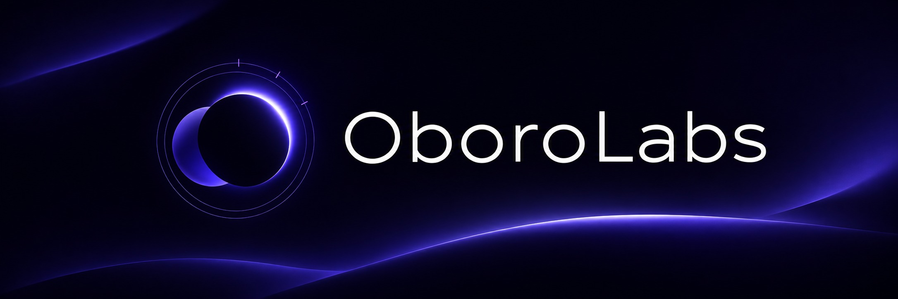

# OboroLabs



[Русская версия](README.ru.md)

OboroLabs is a toolkit for reproducible model benchmarks. The first benchmark compares text-to-image profiles in ComfyUI on the same prompts, seeds, and image sizes. It measures generation latency and combines verified runs with scores from external evaluators.

## Quick start

Install the client from the project directory with Python 3.11 or newer on Linux or macOS.

```bash
python3 -m venv .venv
source .venv/bin/activate
python -m pip install -r requirements.txt
oborolabs --help
```

Set up [ComfyUI and a checkpoint](docs/en/running.md#install-comfyui), then run the [first benchmark](docs/en/running.md#run-a-smoke-benchmark) with the included smoke config.

## Documentation

- [Configure and run a benchmark](docs/en/running.md)
- [Resume runs, read reports, and import evaluator scores](docs/en/results.md)
- [Score images with Tesseract, T2I-CompBench++, and HPS v2.0](docs/en/evaluators.md)
- [Code layout and tests](docs/en/development.md)

## What's next

OboroLabs will grow into a broader model benchmarking library. We plan to add more model workloads, execution backends, and evaluation methods over time.
