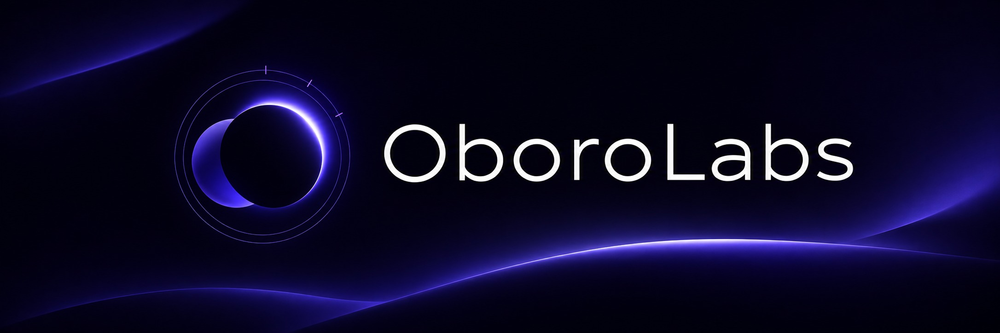

# OboroLabs



[English](README.md)

OboroLabs — набор инструментов для воспроизводимых бенчмарков моделей. Первый бенчмарк сравнивает профили генерации изображений в ComfyUI на одинаковых промптах, seed и размерах. Он измеряет время генерации и объединяет результаты проверенных прогонов с оценками внешних инструментов.

## Быстрый старт

Установите клиент из папки проекта. Нужен Python 3.11 или новее на Linux или macOS.

```bash
python3 -m venv .venv
source .venv/bin/activate
python -m pip install -r requirements.txt
oborolabs --help
```

Установите [ComfyUI и чекпойнт](docs/ru/running.md#установить-comfyui), затем выполните [первый прогон](docs/ru/running.md#запустить-пробный-бенчмарк) с готовой конфигурацией.

## Документация

- [Настройка и запуск бенчмарка](docs/ru/running.md)
- [Возобновление прогонов, отчёты и импорт оценок](docs/ru/results.md)
- [Оценка изображений с Tesseract, T2I-CompBench++ и HPS v2.0](docs/ru/evaluators.md)
- [Структура кода и тесты](docs/ru/development.md)

## Что дальше

OboroLabs будет расти как библиотека для бенчмарков моделей. Планируем добавлять сценарии для новых задач, бэкенды запуска и методы оценки.
